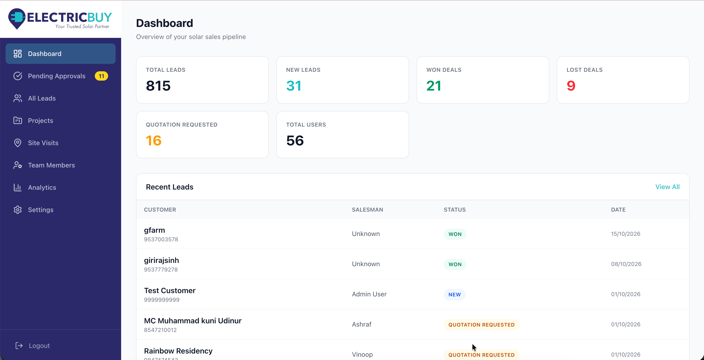
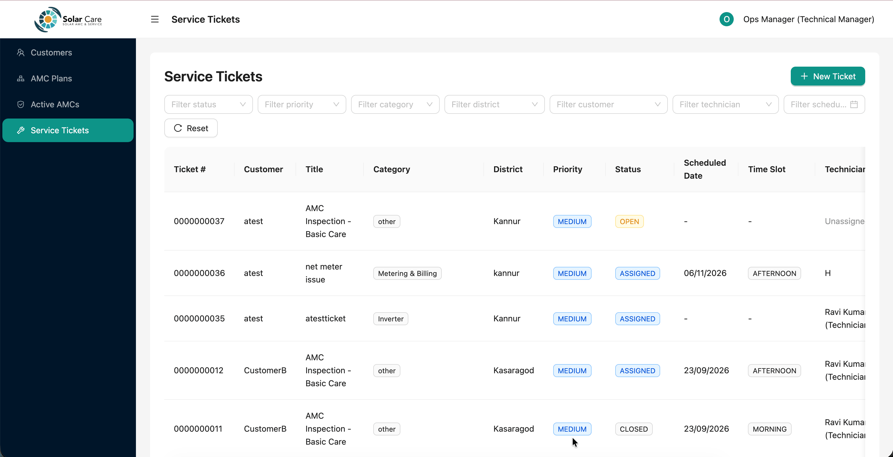
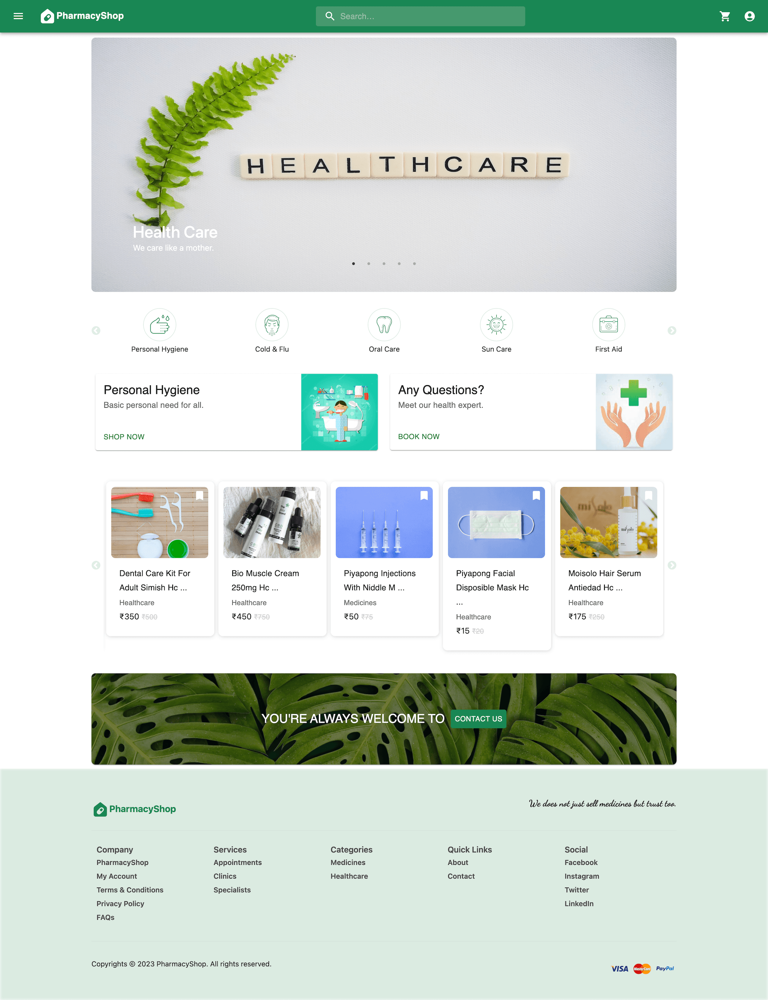

# Girirajsinh Gohil
**Senior Full-Stack, Headless E-Commerce & Mobile Architect**  
11+ Years Experience (2015–2026) | India (IST / Async Remote Ready) 

> **What I Build:** Production-grade web, headless commerce, and cross-platform mobile systems engineered for scale, clean upgrades, and zero-downtime operations. I specialize in taking complex multi-channel architectures from database schema to App Store/Play Store production.

---

### Core Technical Stack

| Domain | Technologies |
| :--- | :--- |
| **Frontend & Mobile** | React, Next.js, Vite, React Native (CLI & Expo), Tailwind CSS, GraphQL, Apollo Client |
| **Backend & Cloud** | Node.js, Express, Knex.js, PostgreSQL, MySQL/MariaDB, OpenSearch, AWS (EC2, S3, SQS) |
| **Headless Commerce** | Magento 2, PWA Studio (Venia, Targetables, UPWARD), Adobe App Builder (I/O Runtime), Custom POS |
| **Payments & Integrations** | Stripe, Razorpay (Webhooks), Ottu, Firebase (FCM), ClinicalTrials.gov API v2, Python AI Services |

---

## Featured Production Builds

### 1. AI Clinical Trial Matching Platform
**Stack:** `Node.js` • `Express` • `PostgreSQL` • `Knex.js` • `React` • `Vite` • `AWS S3/SQS` • `Python AI`

* **High-Volume Data Sync:** Built an automated ETL pipeline syncing **600,000+ clinical trial records** from the ClinicalTrials.gov API v2 into PostgreSQL with checkpointed sequential batching for reliable, low-overhead updates.
* **Secure Document Ingestion:** Implemented direct-to-cloud medical document uploads via **AWS S3 presigned URLs**, queuing background processing through AWS SQS and Python AI microservice endpoints for automated eligibility extraction.
* **Patient Portal & Packet Generation:** Engineered a responsive patient matching portal (React, Vite, Tailwind CSS, React Router v7) featuring dynamic filtering and server-side PDF summary packet generation for physician consultations.
* **Data Integrity & Schema Design:** Designed relational schemas and query optimizations using Knex.js to support sub-second eligibility matching across complex multi-criteria trial parameters.

---

### 2. Electric House Omnichannel Commerce Ecosystem
**Stack:** `Magento 2` • `PWA Studio` • `Adobe App Builder (I/O)` • `React POS` • `React Native` • `GraphQL`

* **Headless Storefront & Quick Commerce:** Architected a high-speed Magento 2 & PWA Studio Venia storefront featuring a dedicated **Quick Commerce mode**, custom GraphQL resolvers, UPWARD routing, and GTM analytics—built strictly with upgrade-safe Targetables and interceptors.
* **Cloud-Native Admin Extensions:** Developed and deployed custom **Adobe App Builder (Admin UI SDK)** microservices on Adobe I/O Runtime to extend Magento backend workflows without core code modifications.
* **Custom React POS & Payment Orchestration:** Built a browser-based Point-of-Sale system in React integrated with **Ottu payment gateways** for unified in-store and online inventory, order, and checkout management.
* **Cross-Platform Mobile Apps:** Shipped and maintained production iOS and Android apps (React Native) on **Apple App Store Connect** and **Google Play**, achieving sub-second catalog browsing and synchronized cart/order states.

---

### 3. ElectricBuy Solar Care — AMC & Field Service Platform
**Stack:** `Node.js` • `MySQL` • `React` • `Vite` • `React Native (Expo)` • `Razorpay` • `Firebase FCM`

* **End-to-End Service Ecosystem:** Architected a unified platform connecting solar asset owners, operations managers, and field technicians across a **Node.js + MySQL** API, a **React + Vite** admin dashboard, and a **React Native Expo** mobile app.
* **Automated Subscription & Billing Engine:** Integrated **Razorpay payment links and idempotent webhooks** to automate Annual Maintenance Contract (AMC) renewals, tiered plan upgrades, and invoice reconciliation.
* **Real-Time Field Workflows:** Built technician dispatch, solar plant health tracking, and service ticket resolution flows backed by real-time status push notifications via **Firebase Cloud Messaging (FCM)**.
* **Role-Based Operations Portal:** Delivered an administrative web console for tracking plant generation metrics, SLA compliance, technician schedules, and recurring revenue analytics.

---

### 4. Zone-Based Hyperlocal Pharmacy Platform
**Stack:** `Next.js` • `Node.js` • `PostgreSQL / PostGIS` • `Stripe` • `Tailwind CSS`

* **Geofenced Zone Routing Engine:** Engineered polygon and radius-based delivery zone resolution so customers automatically view real-time inventory, pricing, and ETA windows specific to their nearest fulfilling pharmacy hub.
* **Compliance-First Checkout Flow:** Built an intuitive Next.js storefront supporting prescription uploads, OTC/Rx cart validation, and automated pharmacist verification gates prior to order dispatch.
* **Stripe Payment & Split-Settlement Flow:** Integrated **Stripe Payment Intents and webhooks** to handle pre-authorizations, instant refunds on out-of-stock prescription items, and multi-zone order reconciliation.
* **Performance & SEO Architecture:** Leveraged Next.js SSR/ISR for fast local landing pages, instant medication search, and high conversion across mobile and desktop browsers.

---

## Experience & Education Snapshot

* **Senior Software Engineer (Contract)** — *Electric House* (2025 – Present)  
  Leading headless PWA, Adobe App Builder, POS, and React Native mobile architecture.
* **Full-Stack & Mobile Systems Architect** — *Independent / Consulting* (2015 – Present)  
  11+ years delivering production SaaS, healthcare, solar-tech, and e-commerce platforms for global remote teams.
* **Bachelor of Computer Applications (BCA)**
